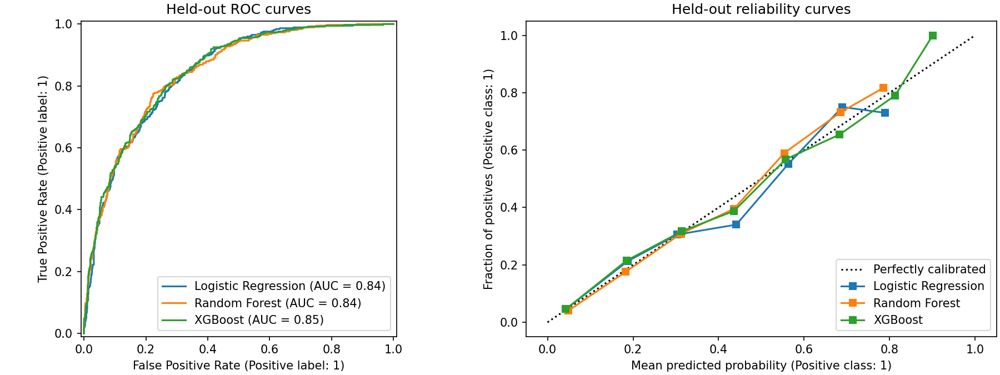
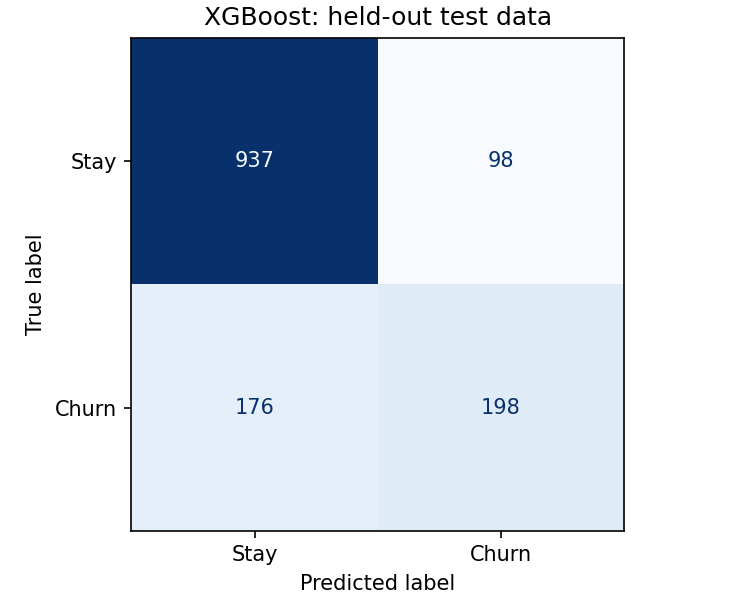

# Customer Churn Prediction

A reproducible machine learning project that compares three classifiers and turns the selected model into an interactive Streamlit dashboard. Built as an ML internship portfolio project by **Bishal Dutta**.

The application estimates a telecom customer's churn probability, assigns an illustrative risk band, and explains which parts of the profile affect the fitted model's estimate.

## Features

- Training-only exploratory analysis of churn balance, tenure, contracts and numeric correlations.
- Validated raw inputs, blank-charge handling, median imputation, one-hot encoding and numeric scaling.
- Leakage-aware comparison of Logistic Regression, Random Forest and XGBoost.
- Precision, recall, F1, ROC-AUC, average precision, accuracy, Brier score and confusion matrices.
- Model selection by five-fold training-only cross-validation, followed by held-out test evaluation.
- Single-customer and CSV batch prediction, probability scores and low/moderate/high risk bands.
- Model-based local sensitivity comparisons and global permutation importance.
- Saved pipeline, standalone model and preprocessing artifacts, with checksums and training metadata.
- Automated tests for input validation, training-only preprocessing, artifact consistency, metrics and dashboard flows.

## Technology stack

Python 3.12 · Pandas · NumPy · SciPy · scikit-learn · Logistic Regression · Random Forest · XGBoost · Streamlit · Matplotlib · Seaborn · joblib · pytest · Ruff

## Dataset

The bundled [Telco Customer Churn CSV](data/telco.csv) comes directly from [IBM's public sample repository](https://github.com/IBM/telco-customer-churn-on-icp4d/blob/d5371f5d83a446ad5673cbcca3b814b926491f8a/data/Telco-Customer-Churn.csv).

- **7,043 customers**, 19 predictors, one customer identifier and one target.
- **Target:** `Churn` (`Yes` = 1, `No` = 0); 1,869 churners and 5,174 non-churners.
- Predictors cover demographics, subscription tenure, services, contracts and billing.
- Eleven blank `TotalCharges` entries become missing values and are imputed using training medians.
- `customerID` and `Churn` are excluded from model inputs. Duplicate customer IDs are rejected.
- Source commit and SHA-256 are recorded in [data/README.md](data/README.md).
- Dataset provenance and original license text are retained in [THIRD_PARTY_NOTICES.md](THIRD_PARTY_NOTICES.md).

The CSV is bundled so training and the app work without a network connection. `python scripts/download_data.py` restores the pinned source bytes if needed.

## ML pipeline

1. Validate the raw schema, labels, customer IDs, numeric ranges and service consistency. This step learns no statistics.
2. Make a stratified **80/20 train/test split** with seed 42: 5,634 training and 1,409 test customers.
3. Explore the training partition only. Save the split membership for reproducibility.
4. For each model, run five-fold stratified cross-validation on the training partition. Each fold fits a fresh `ColumnTransformer`: numeric median imputation and `StandardScaler`; categorical imputation and `OneHotEncoder(handle_unknown="ignore")`.
5. Select the model with the highest mean CV ROC-AUC. Hyperparameters are fixed in source before test evaluation; this is a baseline comparison, not an exhaustive tuning study.
6. Fit each candidate on all training rows, then evaluate each once on the held-out test partition. The test results do not choose the deployed model or tune its threshold.
7. Save the selected training-fitted pipeline and its components. The served artifact is the exact model evaluated in the report; it is not refitted on test data.

No SMOTE, test-informed feature selection, test-set threshold tuning or full-dataset scaling is used. Class imbalance is reported, and churn-class metrics accompany ROC-AUC.

## Actual model comparison

Generated by `python -m telco_churn.train`. Precision, recall and F1 use **Churn = 1** and a **0.50 threshold**. CV standard deviation is across five folds, not a confidence interval. The held-out columns describe the same fixed test partition for all candidates.

<!-- RESULTS:START -->
| Model | CV ROC-AUC (mean ± std) | Test precision | Test recall | Test F1 | Test ROC-AUC |
|---|---:|---:|---:|---:|---:|
| Logistic Regression | 0.8461 ± 0.0125 | 0.6572 | 0.5588 | 0.6040 | 0.8419 |
| Random Forest | 0.8475 ± 0.0090 | 0.6786 | 0.5080 | 0.5810 | 0.8439 |
| XGBoost **(selected)** | 0.8477 ± 0.0106 | 0.6689 | 0.5294 | 0.5910 | 0.8469 |
<!-- RESULTS:END -->

Full-precision results, parameters and fold scores: [reports/metrics.json](reports/metrics.json). Predictions used to calculate test results: [reports/test_predictions.csv](reports/test_predictions.csv).

The CV scores are very close. Selection follows the declared rule and does not establish a statistically meaningful performance difference between the models. Logistic Regression has the highest test F1 at the fixed threshold; XGBoost was chosen for training-CV ranking performance.





## Dashboard

The application has three workspaces:

| Workspace | What it provides |
|---|---|
| Predict churn | Validated customer form, churn probability, predicted class, risk band, local model comparisons, CSV scoring and download |
| Explore data | Training-only sample size, churn rate, missing values, group comparisons and correlations |
| Model performance | Actual CV/test results, ROC and calibration curves, confusion matrix and permutation importance |

**Risk bands:** low below 30%, moderate from 30% to below 60%, high at 60% and above. These are illustrative policy choices, separate from the 50% binary classification threshold.

**Local explanations:** one field group at a time is replaced with the corresponding values of a fixed, representative **actual training customer**. The dashboard reports current probability minus replacement probability in percentage points. Related phone/internet fields move together. The differences are model sensitivities: they are not additive SHAP values, causal effects or guaranteed retention improvements. The exact compared values are visible in the app.

**Global explanations:** permutation importance reports the mean held-out ROC-AUC drop after shuffling a raw feature, with five repeats. Correlated features can share importance. These post-selection diagnostics are not used to choose or retrain the model.

## Project architecture

| Path | Responsibility |
|---|---|
| `app.py` | Streamlit prediction, exploration and evaluation interface |
| `telco_churn/schema.py` | Shared raw feature contract and explanation groups |
| `telco_churn/data.py` | Stateless cleaning and input validation |
| `telco_churn/modeling.py` | Preprocessing and three model pipelines |
| `telco_churn/train.py` | CV selection, final fitting, test reporting and artifact generation |
| `telco_churn/evaluation.py` | Binary classification metrics |
| `telco_churn/eda.py` | Training-only exploratory plots and summaries |
| `telco_churn/inference.py` | Verified loading, prediction, risk bands and explanations |
| `artifacts/` | Selected pipeline, preprocessor, estimator, reference profile and metadata |
| `reports/` | Metrics, split manifest, test predictions, importance and figures |
| `data/` | Pinned raw dataset and provenance |
| `scripts/` | Dataset restoration and artifact verification |
| `tests/` | Unit, artifact, report and Streamlit interaction tests |
| `third_party/` | Retained upstream notices |

## Installation

Use **Python 3.12** for the validated environment. The package supports Python 3.11–3.13 where the pinned dependencies are available.

```bash
git clone https://github.com/i-m-invincible/Churn-Prediction.git
cd Churn-Prediction
python -m venv .venv
```

Activate the environment:

```bash
# Linux / macOS
source .venv/bin/activate

# Windows PowerShell
.venv\Scripts\Activate.ps1
```

Install the runtime dependencies and local package:

```bash
python -m pip install --upgrade pip
python -m pip install -r requirements.txt
python -m pip install -e . --no-deps
```

## Train and verify

The committed artifacts can be used immediately with the pinned dependencies. To reproduce the comparison, plots, README table and selected artifact:

```bash
python -m telco_churn.train
python scripts/verify_artifacts.py
```

Training is CPU-based. Small differences may occur across operating systems or library builds. The seed, dependency versions, data hash, CV scores, split membership and artifact hashes are saved for inspection.

## Run Streamlit

```bash
streamlit run app.py
```

Open the local URL shown by Streamlit, normally `http://localhost:8501`. The app reads local data and artifacts; it does not retrain models on each request or require external API keys.

For batch scoring, upload a CSV using the 19 raw predictor names in `telco_churn/schema.py`. `customerID` and `Churn` columns are optional and excluded from inference. A blank `TotalCharges` value is allowed. Unknown categories, inconsistent service choices, negative charges and missing required fields are rejected with a clear error.

## Development checks

```bash
python -m pip install -r requirements-dev.txt
ruff check .
pytest -q
```

The tests include Streamlit's `AppTest` and do not require a browser or network. CI runs linting, artifact verification and tests with Python 3.12.

## Limitations and future improvements

- Historical sample data does not establish performance for a current telecom provider.
- ROC-AUC measures ranking; probabilities require additional calibration checks on recent data.
- A real retention policy needs contact costs, retention capacity and value estimates to choose a threshold.
- Sensitive demographic inputs are included for comparison with the source dataset. Measure subgroup errors and assess their appropriateness before real use.
- Local replacements can describe unusual combinations and are not recommended customer interventions.
- Next steps: nested CV for hyperparameter tuning, time-based validation on new data, probability calibration, cost-based thresholds, fairness analysis, drift monitoring and native SHAP explanations.
- A public Streamlit deployment is a future step; this repository provides the runnable app, not a hosted service.

## Author

**Bishal Dutta**

GitHub: [https://github.com/i-m-invincible](https://github.com/i-m-invincible)

This independent implementation was developed with AI assistance for code generation, debugging, tests and documentation. The source is intended to be understandable and reproducible for portfolio discussion.

## Acknowledgements

This project was inspired by the Customer Churn Prediction project developed by Ibrahim Khan (ibrahimkhan-data). The implementation in this repository was independently developed, with inspiration drawn from the original project's concept and approach.

Original repository: [ibrahimkhan-data/Customer-Churn-Prediction](https://github.com/ibrahimkhan-data/Customer-Churn-Prediction).

The training pipeline, dashboard, evaluation and inference source were newly implemented. The IBM dataset and retained license notices are third-party material, documented separately.

## License

The new application code is released under the [MIT License](LICENSE). Dataset provenance and third-party notices are documented in [THIRD_PARTY_NOTICES.md](THIRD_PARTY_NOTICES.md).
